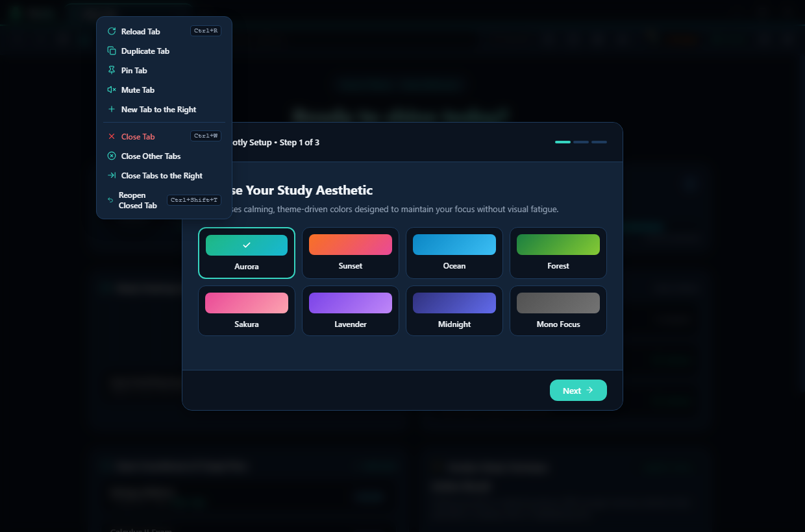

# Hootly

Hootly is a Windows desktop browser with built-in study timers, habit tracking, exam countdowns, and a customizable browser interface. It is an early-stage project; features and site compatibility are still evolving.



## What works today

- Browser tabs with back, forward, reload, home, duplicate, pin, mute, close, and reopen actions.
- `hootly://` pages for the dashboard, streaks, exams, settings, bookmarks, ad blocking, and weekly review.
- Dashboard search with Google, Bing, DuckDuckGo, or Yahoo as the selected search engine.
- Study countdown timer with Pomodoro, Deep Work, and Quick Sprint presets, subject selection, a single five-minute extension, break coaching, and session reflection.
- Daily study goals, streak tracking, XP and levels, rest-token handling, a 12-week activity heatmap, and a small set of study quests.
- Exam countdowns, bookmarks, a command palette, and a study parking lot for saving distractions.
- 16 interface themes, onboarding, reading aids, synthesized rain/cafe/white-noise audio, rotating study tips, and an optional bedtime reminder.
- A basic built-in ad-block host list.

The settings include high-contrast colors and high-legibility text. These are simple reading aids, not a full accessibility suite or a bundled OpenDyslexic font.

## Current limitations

The README previously listed a number of ideas as if they were shipped features. These are not currently available: a free-running stopwatch, account sync, general scheduled study reminders, focus detection across sites, a floating always-on-top timer, a Study Spaces manager, highlight-to-flashcard conversion, an iCalendar deadline planner, seasonal owl outfits, and text-size controls.

Weekly review currently shows basic totals and breakdowns; it does not provide a written reflection or personalized coaching. Study quests and rewards are limited. Citation formatting is a basic metadata-based helper and should be checked before academic use. Ad blocking is a conservative built-in list, not a full extension or filter-list system. Browser extensions and Chrome account sync are not provided.

## Privacy and security

Websites run in isolated, sandboxed browser contents with Node.js integration disabled. Website permission requests are denied unless the user approves a supported permission in Hootly; approvals are temporary and limited to the site and tab. Study sessions, site-time summaries, and preferences are stored on the device. Site time is measured while Hootly is focused and the device is not idle. Hootly does not currently send analytics or telemetry.

See [SECURITY.md](SECURITY.md) for security controls and how to report a vulnerability. Google sign-in opens in the system browser because Google restricts sign-in in embedded browsers.

## Get started

Requirements: Windows 10 or later and Node.js 22 for development.

```bash
git clone https://github.com/edupotnurusrichandan/hootly.git
cd hootly
npm ci
npm run dev
```

To run checks and make a production build:

```bash
npm test
npm run typecheck
npm run build
```

To build Windows installer and portable packages locally:

```bash
npm run dist:win
```

The generated packages are written to `release/`. Packaged builds check GitHub Releases for updates; development runs do not. The release workflow publishes a build when a version tag such as `v0.1.0` is pushed. There may not be a public installer until a release has been published. The current Windows package is not code-signed.

## Data storage

Preferences and study records are kept in Hootly's local application data folder. Password-like values are protected with Electron `safeStorage` when supported by the operating system. There is no account-based synchronization.

## Screenshots

- [Dashboard](screenshots/habit-boosters-dashboard.png)
- [Study timer](screenshots/study-timer.png)
- [Themes](screenshots/aurora-dark.png)

## Contributing

Bug reports and feature requests can be filed in [GitHub Issues](https://github.com/edupotnurusrichandan/hootly/issues). For security vulnerabilities, follow the private reporting guidance in [SECURITY.md](SECURITY.md).
